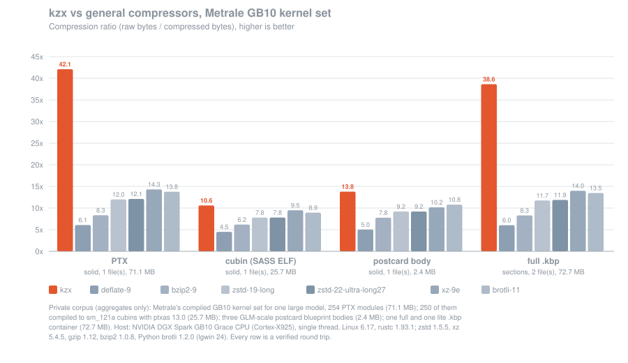
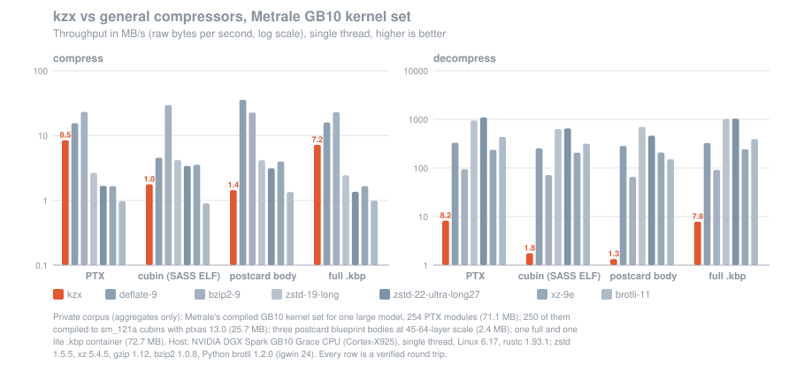
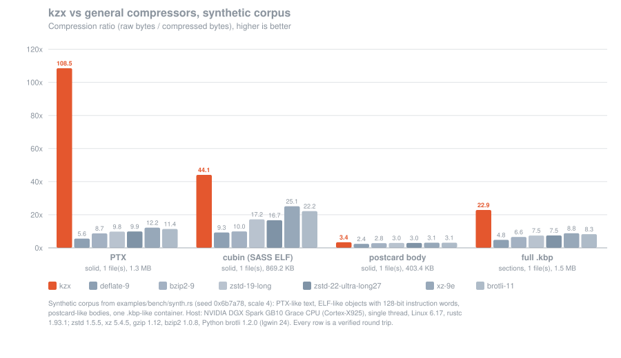
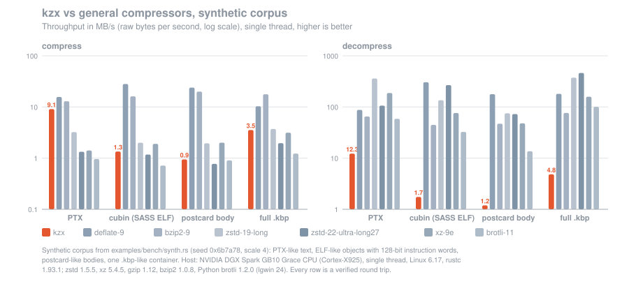

# kzx: kernel compression for GPU kernel artifacts

[](https://crates.io/crates/kzx)
[](https://docs.rs/kzx)
[](https://github.com/tbraun96/kzx/actions/workflows/ci.yml)
[](#licence)
[](#features)
[](Cargo.toml)
[](https://crates.io/crates/kzx)

**kzx** is a `no_std`, zero-dependency **kernel compression** library in Rust: a context-mixing
compressor built for compiled GPU kernel artifacts, **CUDA PTX text** and **cubin/SASS ELF
objects**, and for the small structured (postcard) bodies that describe them. It was written
for the [Metrale](https://metrale.ai) inference engine's `.kbp` blueprint files, which bundle a
signed description of one serve with the compiled kernels it runs, and it beats general-purpose
compressors (deflate, zstd, xz, brotli, bzip2) by a wide margin on that content because it
models what PTX and SASS actually are instead of treating them as bytes.

The crates.io and docs.rs badges resolve once the crate is published.

## Features

- **Ratio first.** On Metrale's GB10 kernel set (254 PTX modules, 71 MB) kzx compresses PTX
  to 1.69 MB, 2.9× smaller than `xz -9e` and 3.5× smaller than `zstd --ultra -22 --long=27`
  (full tables below).
- **Content-aware models.** A reversible PTX transform separates instruction skeletons from
  register numbering; SASS instruction words get 128-bit record contexts; postcard bodies get
  varint-friendly sparse contexts. Content is sniffed per block (ELF magic, PTX banner), or
  chosen explicitly.
- **`no_std` + `alloc`**, **`#![forbid(unsafe_code)]`**, **zero dependencies**, builds for
  `wasm32-unknown-unknown`, `wasm32v1-none` and `thumbv7em-none-eabi`.
- **Deterministic output**: the same input gives the same bytes on every target, so signatures
  over compressed files are stable (all arithmetic is integer; golden tests pin the bytes).
- **Bomb-proof decoding**: the declared output length and the model memory are checked against
  caller-provided caps *before* any allocation; every loop is bounded by a header field; typed
  errors; fuzz-tested with random, mutated and forged streams.
- **Self-describing format**: magic, version, per-block codec id, memory parameter and both
  lengths; streams of independent blocks for multi-section containers.

## Quick start

```toml
[dependencies]
kzx = "0.1"
```

Compress, inspect, decompress under caps:

```rust
let raw: &[u8] = b".version 9.0\n.target sm_90a\n.address_size 64\n.visible .entry k(){ret;}\n";
let packed = kzx::compress(raw);                       // sniffs the content class
let info = kzx::inspect(&packed).unwrap();             // headers only, nothing decoded
assert_eq!(info.blocks[0].profile, kzx::Profile::Ptx);

let limits = kzx::Limits { max_output: 1 << 20, max_memory: 64 << 20 };
let back = kzx::decompress(&packed, &limits).unwrap();
assert_eq!(back, raw);
```

Several sections as independent blocks of one stream (what a container does):

```rust
let body = b"\x01\x05hello\x02\x03abc";                // postcard-like
let kernel = b".version 9.0\n.target sm_90a\n";       // PTX-like
let packed = kzx::compress_blocks(&[&body[..], &kernel[..]]);
let limits = kzx::Limits { max_output: 1 << 16, max_memory: 64 << 20 };
let parts = kzx::decompress_blocks(&packed, &limits).unwrap();
assert_eq!(parts[0], body);
assert_eq!(parts[1], kernel);
```

Refusals are typed and happen before work:

```rust
let packed = kzx::compress(&[7u8; 10_000]);
let tight = kzx::Limits { max_output: 100, max_memory: 64 << 20 };
assert!(matches!(
    kzx::decompress(&packed, &tight),
    Err(kzx::Error::OutputCapExceeded { declared: 10_000, cap: 100 })
));
```

Explicit profile and memory (tables of `2^mem_log2` buckets per context; see
`kzx::memory_bytes`):

```rust
let packed = kzx::compress_with(b"some bytes to model generically", kzx::Profile::Generic, 16).unwrap();
assert_eq!(kzx::inspect(&packed).unwrap().blocks[0].mem_log2, 16);
```

Examples: `cargo run --example quickstart`, `cargo run --release --example file -- c in out`,
`cargo run --release --example bench` (synthetic corpus, plus any of gzip/zstd/xz/bzip2/brotli
found on the host).

## How it works

```text
 input ──► PTX transform ──► skeleton bytes ──► "match continues" flag? ──hit──► byte
 (PTX)     (digit runs of %r/$L            │ miss
            identifiers → marker)          ▼
                      │        8 binary decisions per byte:
                      │        contexts (orders 1–6, word, PTX opcode/field/column,
                      │        SASS 16-byte record) → hashed bucket → bit-history state
                      │        → learned StateMap → stretch → gated logistic Mixer
                      │        → 2× APM/SSE → 32-bit binary arithmetic coder
                      │
                      └──► each marker: number = delta vs. previous of its class,
                           zigzag varint, coded by an inner CM over the delta stream
                           (class tag + line hash fed in for free)
```

kzx is a **context-mixing (PAQ-family) coder**: every bit is predicted by several models whose
stretched probabilities a trained mixer combines, and a binary arithmetic coder spends exactly
`-log2 p` bits on it. Three things make it fit kernel artifacts:

1. **The PTX transform.** Compiled PTX repeats almost exactly except for the numbers inside
   register and label names (`%r123`, `%f4`, `$L__BB6_219`); sequential allocation makes every
   unrolled line differ from its twin by a few digits, which breaks LZ matches and dilutes every
   context. kzx replaces each such digit run with a marker and codes the number separately as a
   delta against the previous number of the same class, through an inner model that sees the
   delta sequence (which repeats in unrolled loops) and the instruction shape. The skeleton that
   remains is mostly long exact repeats, so most of its bytes are coded as one "match continues"
   decision, which is also why kzx runs at ~8 MB/s on PTX instead of the ~1 MB/s typical of CM.
   The transform is exact for arbitrary input (escapes for raw `0x01`/`0x02`).
2. **Bit-history states.** Each context keeps a one-byte nonstationary bit history per nibble
   node (15 per 16-byte bucket) and learns the state → probability map online, so a context
   that has been deterministic says so, and tables hold four times more contexts than 32-bit
   counters would.
3. **A long-range match model** with the whole block as its window, so duplication across
   kernels in a solid payload is captured; the mixer's weight set is selected by the match
   length, so it knows when to trust it.

`DESIGN.md` has the full architecture, the rejected alternatives and the measurements behind
each choice.

## Format

```text
stream  = "kzx" u8:version=1  u32le:block_count  block*
block   = u8:codec  u8:mem_log2  u16le:reserved=0  u64le:raw_len  u64le:packed_len  bytes[packed_len]
codec   = 0 stored | 1 cm-generic | 2 cm-ptx | 3 cm-elf
```

Blocks are independent (own model, own window). `mem_log2` ∈ 10..=26 sizes the context tables;
`kzx::memory_bytes(codec, mem_log2)` is exactly what the decoder allocates. `raw_len` is the
declared output; the `packed_len`s must tile the stream exactly. Inputs under 24 bytes are
stored. Any model change that alters the bytes of the golden fixtures is a format change and
bumps the version byte.

## Safety guarantees

Decompression may run before a payload's hash is checked, so the bounds are hard, not best
effort:

| Hazard | Guarantee |
|---|---|
| Output bomb | `inspect` sums the declared lengths with checked arithmetic and refuses above `Limits::max_output` before allocating anything. |
| Memory bomb | The memory parameter is range-checked and `memory_bytes` must fit `Limits::max_memory`, per block, before allocating. |
| Hang | Every loop is bounded by a header field or a constant (block count ≤ 65 536, bytes = `raw_len`, ≤ 10 varint bytes per number, ≤ 48-byte match verification). The coder never waits for input. |
| Panic | No input-derived indexing without a mask or a bounds check; `#![forbid(unsafe_code)]`; `tests/fuzz.rs` drives 3 000 random streams, 750 mutations of valid streams and 500 forged headers with a fixed seed, asserting no panic, bounded output and typed refusals. |
| Wrong bytes | A corrupt stream decodes to the declared length with wrong content; the caller's hash check catches it (kzx carries no checksum of its own by design: the container already has one). |

## Benchmarks

Two corpora are reported. The **private** one is what kzx was tuned on: Metrale's compiled
GB10 kernel set for one large model (254 PTX modules, 71.1 MB), the same modules compiled to
`sm_121a` cubins where ptxas accepts them (250 objects, 25.7 MB), three postcard blueprint
bodies at the scale of a 45–64-layer model (0.76–0.83 MB each, real kernel names, hashes and
lever names) and the full and lite `.kbp` containers around them (71.9 MB and 0.84 MB). Only aggregate numbers are published; the corpus is not.
The **synthetic** one ships in `examples/bench/synth.rs` so anyone can reproduce the shape of
the result: template-generated PTX-like text, ELF-like objects with structured 128-bit
instruction words, postcard-like bodies and a container.

Baselines are the host CLIs: `gzip -9` (deflate), `bzip2 -9`, `zstd -19 --long -T1`,
`zstd --ultra -22 --long=27 -T1`, `xz -9e -T1`, and Brotli quality 11 with a 16 MiB window
through the Python binding (`brotli` 1.2.0; the CLI is not installed). Every row is a verified
round trip. Modes: `per-file` = each file its own stream, sums reported; `solid` = all files
concatenated into one stream; `sections` = kzx compresses the `.kbp` header, body, locator,
payload and signature as five blocks of one stream while the baselines see the whole file.

### Metrale GB10 kernel set (private corpus)





<!-- BEGIN private-tables -->
**PTX**, `per-file`: 254 file(s), 71,054,624 raw bytes

| tool | packed bytes | ratio | compress MB/s | decompress MB/s |
|---|---:|---:|---:|---:|
| **kzx** | 2,231,579 | 31.84x ★ | 6.61 | 6.60 |
| deflate-9 | 11,769,012 | 6.04x | 8.39 | 84.23 |
| zstd-19-long | 6,488,752 | 10.95x | 1.85 | 106.91 |
| zstd-22-ultra-long27 | 6,467,058 | 10.99x | 0.66 | 134.48 |
| xz-9e | 5,531,788 | 12.84x | 2.29 | 135.22 |
| bzip2-9 | 8,716,891 | 8.15x | 11.25 | 33.86 |
| brotli-11 | 5,664,115 | 12.54x | 1.17 | 20.97 |

**PTX**, `solid`: 1 file(s), 71,054,624 raw bytes

| tool | packed bytes | ratio | compress MB/s | decompress MB/s |
|---|---:|---:|---:|---:|
| **kzx** | 1,687,840 | 42.10x ★ | 8.45 | 8.21 |
| deflate-9 | 11,682,938 | 6.08x | 15.48 | 328.17 |
| zstd-19-long | 5,926,538 | 11.99x | 2.65 | 946.37 |
| zstd-22-ultra-long27 | 5,874,083 | 12.10x | 1.67 | 1090.81 |
| xz-9e | 4,961,584 | 14.32x | 1.66 | 235.78 |
| bzip2-9 | 8,524,602 | 8.34x | 23.14 | 93.78 |
| brotli-11 | 5,159,171 | 13.77x | 0.97 | 434.35 |

**cubin (SASS ELF)**, `per-file`: 250 file(s), 25,655,032 raw bytes

| tool | packed bytes | ratio | compress MB/s | decompress MB/s |
|---|---:|---:|---:|---:|
| **kzx** | 3,534,748 | 7.26x ★ | 1.61 | 1.72 |
| deflate-9 | 5,824,567 | 4.40x | 4.35 | 105.91 |
| zstd-19-long | 4,332,468 | 5.92x | 1.58 | 70.52 |
| zstd-22-ultra-long27 | 4,331,606 | 5.92x | 0.32 | 60.89 |
| xz-9e | 3,647,852 | 7.03x | 3.28 | 75.86 |
| bzip2-9 | 4,973,833 | 5.16x | 18.13 | 44.51 |
| brotli-11 | 3,880,450 | 6.61x | 1.14 | 9.03 |

**cubin (SASS ELF)**, `solid`: 1 file(s), 25,655,032 raw bytes

| tool | packed bytes | ratio | compress MB/s | decompress MB/s |
|---|---:|---:|---:|---:|
| **kzx** | 2,420,023 | 10.60x ★ | 1.77 | 1.75 |
| deflate-9 | 5,702,004 | 4.50x | 4.54 | 253.21 |
| zstd-19-long | 3,294,856 | 7.79x | 4.18 | 630.24 |
| zstd-22-ultra-long27 | 3,286,082 | 7.81x | 3.39 | 650.83 |
| xz-9e | 2,704,308 | 9.49x | 3.54 | 206.23 |
| bzip2-9 | 4,150,914 | 6.18x | 29.47 | 71.22 |
| brotli-11 | 2,871,713 | 8.93x | 0.90 | 315.03 |

**postcard body**, `per-file`: 3 file(s), 2,404,613 raw bytes

| tool | packed bytes | ratio | compress MB/s | decompress MB/s |
|---|---:|---:|---:|---:|
| **kzx** | 240,198 | 10.01x ★ | 1.30 | 1.38 |
| deflate-9 | 479,634 | 5.01x | 34.76 | 267.42 |
| zstd-19-long | 345,877 | 6.95x | 3.92 | 384.33 |
| zstd-22-ultra-long27 | 345,877 | 6.95x | 1.65 | 350.11 |
| xz-9e | 312,940 | 7.68x | 4.01 | 130.51 |
| bzip2-9 | 317,511 | 7.57x | 17.76 | 48.08 |
| brotli-11 | 304,689 | 7.89x | 1.32 | 53.86 |

**postcard body**, `solid`: 1 file(s), 2,404,613 raw bytes

| tool | packed bytes | ratio | compress MB/s | decompress MB/s |
|---|---:|---:|---:|---:|
| **kzx** | 174,257 | 13.80x ★ | 1.44 | 1.34 |
| deflate-9 | 479,778 | 5.01x | 35.46 | 283.18 |
| zstd-19-long | 261,509 | 9.20x | 4.15 | 696.24 |
| zstd-22-ultra-long27 | 261,489 | 9.20x | 3.12 | 460.13 |
| xz-9e | 236,456 | 10.17x | 3.95 | 207.45 |
| bzip2-9 | 309,940 | 7.76x | 22.55 | 65.19 |
| brotli-11 | 222,735 | 10.80x | 1.34 | 150.49 |

**full `.kbp`**, `sections`: 2 file(s), 72,740,658 raw bytes

| tool | packed bytes | ratio | compress MB/s | decompress MB/s |
|---|---:|---:|---:|---:|
| **kzx** | 1,883,193 | 38.63x ★ | 7.17 | 7.84 |
| deflate-9 | 12,057,892 | 6.03x | 15.86 | 326.15 |
| zstd-19-long | 6,192,397 | 11.75x | 2.43 | 1014.50 |
| zstd-22-ultra-long27 | 6,128,374 | 11.87x | 1.35 | 1031.40 |
| xz-9e | 5,198,532 | 13.99x | 1.65 | 240.96 |
| bzip2-9 | 8,774,072 | 8.29x | 22.84 | 91.21 |
| brotli-11 | 5,396,808 | 13.48x | 0.98 | 392.06 |

<!-- END private-tables -->

### Synthetic corpus (reproducible)

`cargo run --release --example bench -- --out results.csv` regenerates these rows on any host.





<!-- BEGIN synthetic-tables -->
**PTX**, `per-file`: 16 file(s), 1,334,364 raw bytes

| tool | packed bytes | ratio | compress MB/s | decompress MB/s |
|---|---:|---:|---:|---:|
| **kzx** | 19,978 | 66.79x ★ | 5.56 | 5.53 |
| deflate-9 | 240,045 | 5.56x | 11.65 | 78.22 |
| zstd-19-long | 152,002 | 8.78x | 1.14 | 46.82 |
| zstd-22-ultra-long27 | 152,392 | 8.76x | 0.22 | 21.09 |
| xz-9e | 123,940 | 10.77x | 2.15 | 38.07 |
| bzip2-9 | 177,848 | 7.50x | 15.64 | 41.77 |
| brotli-11 | 125,357 | 10.64x | 0.78 | 3.38 |

**PTX**, `solid`: 1 file(s), 1,334,364 raw bytes

| tool | packed bytes | ratio | compress MB/s | decompress MB/s |
|---|---:|---:|---:|---:|
| **kzx** | 12,298 | 108.50x ★ | 9.09 | 12.25 |
| deflate-9 | 239,670 | 5.57x | 15.69 | 87.75 |
| zstd-19-long | 136,127 | 9.80x | 3.23 | 360.56 |
| zstd-22-ultra-long27 | 134,597 | 9.91x | 1.33 | 106.13 |
| xz-9e | 109,472 | 12.19x | 1.41 | 187.78 |
| bzip2-9 | 152,625 | 8.74x | 12.96 | 65.03 |
| brotli-11 | 116,890 | 11.42x | 0.96 | 58.63 |

**cubin (SASS ELF)**, `per-file`: 16 file(s), 869,248 raw bytes

| tool | packed bytes | ratio | compress MB/s | decompress MB/s |
|---|---:|---:|---:|---:|
| **kzx** | 39,317 | 22.11x ★ | 1.61 | 1.66 |
| deflate-9 | 92,675 | 9.38x | 10.47 | 25.97 |
| zstd-19-long | 50,837 | 17.10x | 0.56 | 19.12 |
| zstd-22-ultra-long27 | 50,918 | 17.07x | 0.15 | 16.47 |
| xz-9e | 43,508 | 19.98x | 1.26 | 32.75 |
| bzip2-9 | 82,054 | 10.59x | 8.38 | 19.38 |
| brotli-11 | 47,745 | 18.21x | 0.56 | 2.47 |

**cubin (SASS ELF)**, `solid`: 1 file(s), 869,248 raw bytes

| tool | packed bytes | ratio | compress MB/s | decompress MB/s |
|---|---:|---:|---:|---:|
| **kzx** | 19,713 | 44.10x ★ | 1.35 | 1.75 |
| deflate-9 | 93,632 | 9.28x | 28.09 | 304.45 |
| zstd-19-long | 50,454 | 17.23x | 2.00 | 135.29 |
| zstd-22-ultra-long27 | 52,053 | 16.70x | 1.18 | 267.26 |
| xz-9e | 34,624 | 25.11x | 1.90 | 76.06 |
| bzip2-9 | 87,331 | 9.95x | 16.15 | 44.70 |
| brotli-11 | 39,181 | 22.19x | 0.72 | 32.58 |

**postcard body**, `per-file`: 3 file(s), 403,395 raw bytes

| tool | packed bytes | ratio | compress MB/s | decompress MB/s |
|---|---:|---:|---:|---:|
| **kzx** | 125,114 | 3.22x ★ | 1.24 | 1.34 |
| deflate-9 | 165,479 | 2.44x | 18.21 | 73.99 |
| zstd-19-long | 155,779 | 2.59x | 1.14 | 23.66 |
| zstd-22-ultra-long27 | 155,779 | 2.59x | 0.32 | 28.82 |
| xz-9e | 142,292 | 2.83x | 1.72 | 30.52 |
| bzip2-9 | 160,626 | 2.51x | 9.81 | 23.15 |
| brotli-11 | 144,425 | 2.79x | 0.53 | 4.93 |

**postcard body**, `solid`: 1 file(s), 403,395 raw bytes

| tool | packed bytes | ratio | compress MB/s | decompress MB/s |
|---|---:|---:|---:|---:|
| **kzx** | 120,053 | 3.36x ★ | 0.94 | 1.19 |
| deflate-9 | 167,478 | 2.41x | 23.86 | 177.89 |
| zstd-19-long | 136,537 | 2.95x | 1.95 | 75.29 |
| zstd-22-ultra-long27 | 136,371 | 2.96x | 0.77 | 72.66 |
| xz-9e | 129,464 | 3.12x | 2.00 | 47.83 |
| bzip2-9 | 142,402 | 2.83x | 19.95 | 47.16 |
| brotli-11 | 128,722 | 3.13x | 0.90 | 13.65 |

**full `.kbp`**, `sections`: 1 file(s), 1,489,027 raw bytes

| tool | packed bytes | ratio | compress MB/s | decompress MB/s |
|---|---:|---:|---:|---:|
| **kzx** | 65,122 | 22.87x ★ | 3.54 | 4.82 |
| deflate-9 | 309,607 | 4.81x | 10.34 | 180.56 |
| zstd-19-long | 199,705 | 7.46x | 3.71 | 374.46 |
| zstd-22-ultra-long27 | 198,871 | 7.49x | 1.96 | 462.01 |
| xz-9e | 169,036 | 8.81x | 3.14 | 158.23 |
| bzip2-9 | 226,715 | 6.57x | 17.72 | 76.38 |
| brotli-11 | 180,195 | 8.26x | 1.23 | 100.78 |

<!-- END synthetic-tables -->

Host: NVIDIA DGX Spark GB10, Grace CPU (Arm Cortex-X925/A725), single thread, Linux
6.17, rustc 1.93.1, `-O` release profile; zstd 1.5.5, xz 5.4.5, gzip 1.12, bzip2 1.0.8, Python
brotli 1.2.0. Timings are wall-clock around one process (baselines) or one call (kzx) and
include the model allocation; kzx tables are sized from the input (`default_mem_log2`), about
0.5 GB for a 71 MB solid PTX block (`kzx::memory_bytes(Profile::Ptx, 22)`). Raw CSVs: `assets/bench/private.csv`,
`assets/bench/synthetic.csv`; charts are rendered from them by `scripts/charts.py`.

### Where kzx loses

- **Speed.** Compression and decompression run at the same speed, 1.3–1.8 MB/s on ELF and
  postcard content and ~8 MB/s on PTX, against 200–1000 MB/s for zstd/xz decompression. kzx is
  for artifacts decoded once at load (the full 71 MB kernel set in 8.7 s single-threaded), not
  for a hot path. Blocks are independent, so a loader can split a payload and decode blocks on
  several threads.
- **Memory.** A solid 71 MB PTX block uses ~0.5 GB of model tables at the default parameter;
  the caller chooses the cap and the encoder's `mem_log2` trades ratio for memory.
- **Incompressible sections.** Signature blocks and hash tables (the locator, parts of the
  body) are random; kzx stores or barely shrinks them, like every compressor.
- **Small inputs.** Under a few KB the 20-byte block header and the model warm-up cost a few
  percent; inputs under 24 bytes are stored.

## Why kzx?

The `.kbp` payload is tens of megabytes of compiled kernels that are hashed, signed, mirrored
and fetched, and a lite blueprint has to fit in a pasteable `kbp1.<base64>` string. The
general compressors are byte-oriented LZ (+ entropy coding, + a long window): they cannot see
that two PTX lines are the same instruction with different register numbers, that a SASS
object is a column of 128-bit words with fixed fields, or that the numbers in a postcard body
are varints. We needed, in one crate: ratio beyond LZ on exactly this content, `no_std` and
`wasm32` (the blueprint store verifies with the same code), deterministic bytes (stable
signatures), zero dependencies (a pure-core crate in a gated workspace), and hard bounds on
untrusted input (decoding runs before the hash check). No existing crate offers that
combination, and the ratio gap over the best LZ coder on PTX is about 2.9×, so the cost (a
compressor of ~2 600 lines, speed in the single-digit MB/s) was worth paying. Decode happens
once per load; every byte saved is saved on every mirror and every fetch.

## Licence

Licensed under either of

- Apache License, Version 2.0 ([LICENSE-APACHE](LICENSE-APACHE) or <http://www.apache.org/licenses/LICENSE-2.0>)
- MIT license ([LICENSE-MIT](LICENSE-MIT) or <http://opensource.org/licenses/MIT>)

at your option. Unless you explicitly state otherwise, any contribution intentionally submitted
for inclusion in the work by you, as defined in the Apache-2.0 license, shall be dual licensed
as above, without any additional terms or conditions.

Built for the [Metrale](https://metrale.ai) inference engine.
